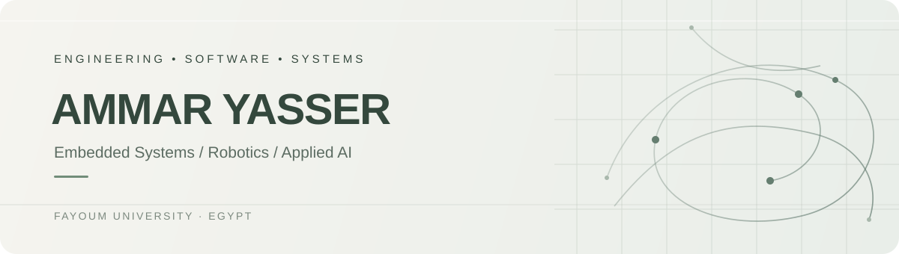

  
   
  <a href="https://www.linkedin.com/in/ammar-yasser-ece">LinkedIn</a>
  &nbsp; · &nbsp;
  <a href="mailto:aym1352006@gmail.com">Email</a>
  &nbsp; · &nbsp;
  <a href="https://github.com/Ammar-Y206">GitHub</a>

 

## A little about me

I'm an engineering student at **Fayoum University, Egypt**. I'm interested in the intersection of **hardware and software** — especially embedded systems, robotics, and applied machine learning.

I like building things, exploring how systems work, and learning through hands-on projects.

## What I'm interested in

- **Embedded systems** — C/C++, microcontrollers, and hardware–software interaction
- **Robotics** — ROS 2, sensing, and autonomous systems
- **AI & machine learning** — predictive models and anomaly detection

## Selected projects

<table>
  <tr>
    <td width="50%" valign="top">
      <strong><a href="https://github.com/Ammar-Y206/ros2-mastery">ROS 2 Mastery</a></strong> 
      An interactive learning platform that makes ROS 2 concepts easier to explore visually. 
      ROS 2 · Robotics · TypeScript
    </td>
    <td width="50%" valign="top">
      <strong><a href="https://github.com/Ammar-Y206/Solar-Plant-Power-Prediction-Fault-Detection">Solar Plant Prediction & Fault Detection</a></strong> 
      Forecasting solar power and identifying unusual behavior in photovoltaic data. 
      Python · LightGBM · Machine Learning
    </td>
  </tr>
  <tr>
    <td width="50%" valign="top">
      <strong><a href="https://github.com/Ammar-Y206/Multi-Sensor-Fusion-Simulator">Multi-Sensor Fusion Simulator</a></strong> 
      A MATLAB simulation for sensor filtering, fusion, and reactive obstacle avoidance. 
      MATLAB · Sensor Fusion · Robotics
    </td>
    <td width="50%" valign="top">
      <strong><a href="https://github.com/abdo7820/Hotel-Booking-Cancellation-Prediction-System">Hotel Booking Cancellation Prediction</a></strong> 
      A machine learning workflow for predicting booking cancellations and comparing models. 
      Python · XGBoost · FastAPI · Docker
    </td>
  </tr>
  <tr>
    <td width="50%" valign="top">
      <strong><a href="https://github.com/Ammar-Y206/ds-salaries-eda">Data Science Salaries — EDA</a></strong> 
      Exploring salary patterns across experience levels, company sizes, and locations. 
      Python · Pandas · Power BI
    </td>
    <td width="50%" valign="top">
      <strong><a href="https://github.com/Ammar-Y206/interactive-linear-algebra">Interactive Linear Algebra</a></strong> 
      A visual, hands-on way to explore core linear algebra concepts. 
      Mathematics · Interactive Learning
    </td>
  </tr>
</table>

## Tools I use

  

---

  Learning by building — one project at a time.

